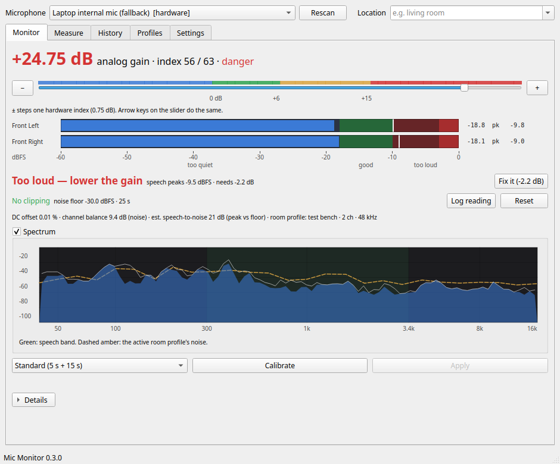
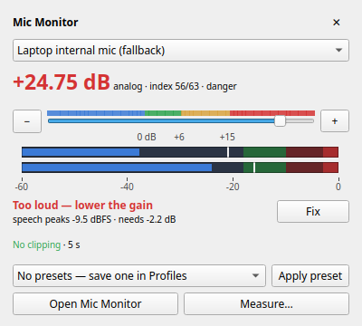
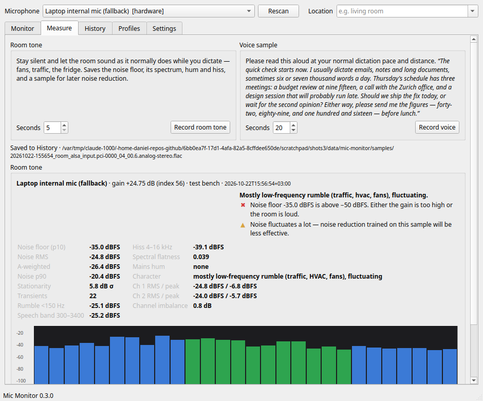

# Mic Monitor

> *See what your microphone is really doing — tuned for dictation and speech recognition.*

**Write-up:** [The Linux mic slider lies: Mic Monitor shows the real gain](https://blog.danielrosehill.com/posts/linux-microphone-gain-dictation-mic-monitor-kaq5pj)

A KDE Plasma (Qt 6) microphone monitor that lives in the system tray. It shows
the **true analog gain** of a capture device in dB, its **signal level** in
dBFS against the band speech recognition wants, and **whether it is clipping**,
counted in samples. You can step the gain one hardware index at a time. It also
records room tone and voice samples, measures them, keeps a history per
microphone and location, and can ask an AI model for a review.



## Why

Every microphone GUI on Linux misreports gain, because PipeWire/PulseAudio
volume is not the analog preamp gain, and the mapping between the two is
neither linear nor lossless. On the reference laptop (Realtek ALC257) the two
readings, taken at the same instant, differed by **60 dB**:

| Reported by | Value |
|---|---|
| `pactl` / pavucontrol / Plasma audio applet | 12% / −55.25 dB |
| ALSA `Capture` control (the real preamp) | index 29/63 / **+4.50 dB** |

The whole usable analog range is squeezed into `pactl` 5%–35%. Anything above
35% is pinned at maximum boost. Clipping at the preamp is analog damage, so **no
filter, AGC or noise suppressor downstream can repair it**. Full measurements
are in [`docs/gain-mapping.md`](docs/gain-mapping.md).

## What it does

| Tab | What's there |
|---|---|
| **Monitor** | The analog gain in dB, colour-zoned by the device's own curve, with − / + buttons that move one hardware step (0.75 dB on HDA). Per-channel meters with peak hold and the −18…−10 dBFS target band, and a live verdict ("too loud — needs −6 dB", with a **Fix it** button). It also counts clipped samples and runs, shows DC offset, channel balance and an estimated speech-to-noise ratio, and has a live spectrum with the active room profile overlaid. Calibration comes in three lengths, Quick, Standard and Thorough (3+8 s, 5+15 s, 10+30 s), and **Log reading** saves the current state to History. |
| **Measure** | **Room tone** (5–120 s): noise floor (p10, RMS, A-weighted), stationarity, transients, rumble, speech-band and hiss energy, mains hum (50/60 Hz plus harmonics), spectral flatness, 1/3-octave bands, and a sox noise profile for later cleanup. **Voice sample** (10–120 s, read the passage shown): speech peak and RMS, SNR against the active room profile, crest factor, dynamic range, pitch (F0) median and range, spectral centroid and tilt, bandwidth (it catches Bluetooth HFP narrowband), rumble, presence, sibilance, plosive pops and channel imbalance. All of that feeds an **ASR readiness score** from 0 to 100 with named deductions, plus a suggested gain. |
| **History** | Every measurement, with device, gain, location, notes, sample file and AI review. Filter by device or kind, play a sample, ask the AI, promote a measurement to a profile, or export everything as JSON. |
| **Profiles** | **Gain presets** per microphone ("office", "living room"); the ★ preset is the remembered gain that Restore, the tray and the login unit reapply. **Room noise profiles**: the active one per device is the SNR reference and the spectrum overlay, and each has a "copy sox cleanup command" action. **Voice profiles** as well. |
| **Settings** | OpenRouter key and model, an option to send the audio as well as the numbers, tray behaviour, start at login, auto-restore on drift, and the data folder. |

| Tray pop-up | Room tone analysis |
|---|---|
|  |  |

**Tray** (Plasma StatusNotifierItem):
- **Left-click** opens a pop-up with the device, a gain slider and ± buttons, a live meter, the verdict and preset choice. It listens only while it's open.
- **Middle-click** opens the main window. **Right-click** opens a menu with presets, Restore remembered gain and Quit.
- The icon dot shows the gain zone. It turns amber with "!" and sends a notification when **something else moves your gain**. wireplumber does this, and it was seen resetting the preamp to maximum.

**Microphones with no analog control** (Bluetooth headsets, processed virtual sources) fall back to PipeWire software volume in 1% steps, clearly labelled as digital.

## What it does not do

Mic Monitor inserts **no** audio processing, no filter, no virtual source and no
AGC, and installs nothing into `/etc`. It observes, sets gain, and records only
when you ask it to. The sibling project [`dictamic`](https://github.com/danielrosehill/dictamic)
took the processing route. Measurement showed raw audio at *correct* gain had a
**9 dB lower noise floor** than that whole chain, so Mic Monitor makes correct gain
easy instead.

## Install

From the signed APT repository at `apps.danielrosehill.com/apt` (updates arrive with `sudo apt upgrade`):

```bash
curl -fsSL https://apps.danielrosehill.com/apt/setup.sh | sudo sh -s -- mic-monitor
```

If the repository is already set up on the machine:

```bash
sudo apt update && sudo apt install mic-monitor
```

Or install the `.deb` from the [latest release](https://github.com/danielrosehill/Mic-Monitor/releases/latest):

```bash
sudo apt install ./mic-monitor_*_all.deb
```

Then run `mic-monitor`, or `mic-monitor --tray` to start in the tray only (what "Start in the tray at login" runs).
Tested on Ubuntu 26.04; it needs only archive packages (PyQt6, numpy), so 24.04 and later should work. It's built for KDE Plasma and works on any desktop with a StatusNotifierItem tray.

Depends: `python3-pyqt6 python3-numpy pulseaudio-utils alsa-utils`.
Recommends: `sox` (FLAC samples and noise profiles), `ffmpeg` (audio for AI),
`pipewire-bin` (playback), `libkf6config-bin` and `qdbus-qt6` (KWin pop-up placement).

**Formerly `micscope`** (v0.1–0.2). The `mic-monitor` package replaces it, and on first run it moves
`~/.config/micscope` and `~/.local/share/micscope` to the new names and renames the KWin rule,
autostart entry and login unit.

## Command line (scripts and agents)

```bash
mic-monitor --list [--json]                 # every source with real analog gain, presets, remembered gain
mic-monitor --measure room --seconds 15 --location "living room"   # records, analyses, logs; prints JSON
mic-monitor --measure voice --seconds 20
mic-monitor --history [--json]              # the measurement log
mic-monitor --restore [--delay 8]           # reapply remembered gain (used by the login unit)
```

## Files

| Path | Contents |
|---|---|
| `~/.config/mic-monitor/devices.json` | remembered gain per device, named presets, probed-curve cache |
| `~/.config/mic-monitor/settings.json` | settings, including the OpenRouter key (mode 600). `OPENROUTER_API_KEY` in the environment also works. |
| `~/.local/share/mic-monitor/history.db` | SQLite: `measurements`, `profiles` |
| `~/.local/share/mic-monitor/samples/` | room and voice FLACs, plus `.noiseprof` for each room sample |
| `~/.config/kwinrulesrc` group `mic-monitor-tray-popup` | KWin rule that places the pop-up (see [`docs/kde-integration.md`](docs/kde-integration.md)) |

## Build

```bash
./build-deb.sh            # version from micmonitor/__init__.py → dist/mic-monitor_<v>_all.deb
python3 -m micmonitor       # run from the source tree
```

## Docs

- [`docs/spec.md`](docs/spec.md): design, constraints, acceptance criteria
- [`docs/gain-mapping.md`](docs/gain-mapping.md): the measured pactl ↔ ALSA mapping
- [`docs/analysis.md`](docs/analysis.md): what every metric means and the thresholds behind the findings and score
- [`docs/kde-integration.md`](docs/kde-integration.md): tray, pop-up placement on Wayland, and the microphone-in-use indicator
